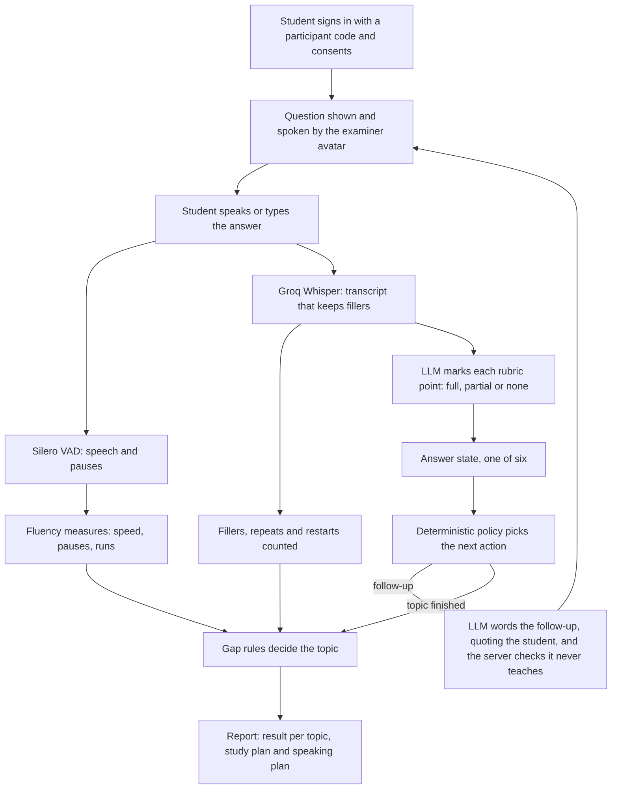
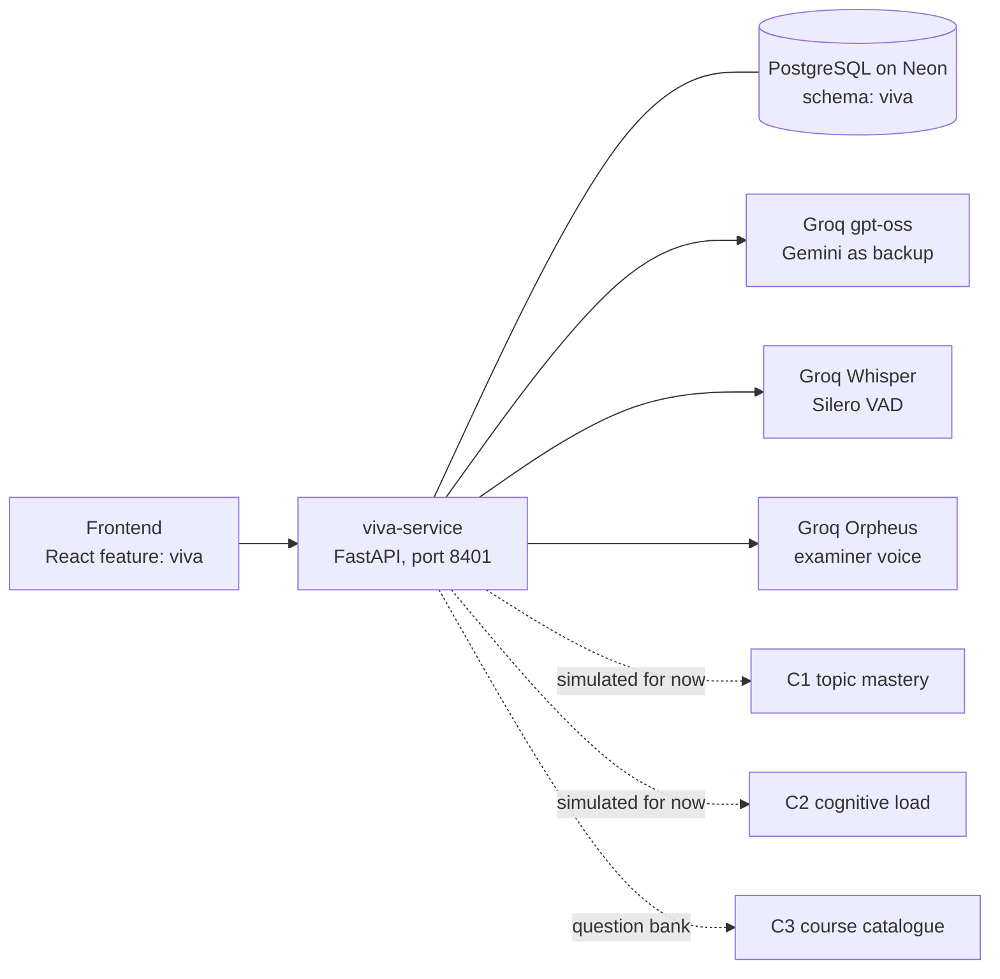

# C4: Intelligent Viva System

**AdaptLearn, SLIIT final-year research project J26-IT-360**

| | |
|---|---|
| Component | C4 Intelligent Viva System |
| Student | R. J. Vanderheyden (IT23212022) |
| Platform | AdaptLearn, with C1 Adaptive Curriculum, C2 Cognitive Load Detection and C3 AI Tutoring |
| Status | Progress Presentation 1 completed on 21 Oct 2026; Progress Presentation 2 in progress |
| Code | `backend/services/viva-service` (API), `frontend/src/features/viva` (screens), `research/c4-viva` (study and analysis) |

---

## 1. Overview

In a spoken technical viva, a weak answer is usually read as "the student does not know".
For a Sri Lankan student answering in English, their second language (L2), a weak answer can
also mean "the student knows it but cannot say it well". The two need different help, and
confusing them is unfair to the student.

C4 is an AI viva examiner. It asks technical questions aloud, listens to the spoken answer,
marks it against a rubric, asks follow-up questions that never teach the answer, and then
decides, for each topic, whether the evidence points to a **likely knowledge gap** or a
**likely communication difficulty**. The speech side of that decision uses fluency thresholds
derived from the researcher's own pilot study, in which the students' knowledge was controlled
with a quiz.

### The research problem

- Vivas confuse two different problems: a short, hesitant answer looks the same whether the
  student lacks the knowledge or lacks the words.
- This affects L2 speakers most. Pausing, searching for words and restarting are normal in L2
  speech.
- Human vivas are hard to scale and inconsistent. Follow-ups vary by examiner and can
  accidentally teach the answer, which hides what the student knew before.
- Counting "um" alone is not enough: transcribers drop fillers, and fluent speakers use them too.

### Research question

When knowledge is controlled, which speech measures separate Sri Lankan undergraduates who have
communication difficulty in English technical vivas from those who do not, and at what
thresholds?

**Hypothesis H1:** students with communication difficulty speak more slowly, in shorter runs,
with longer and more frequent silent pauses (speech rate, mean length of run, mean silent pause
and silent pauses per minute differ between the groups).

---

## 2. Objectives

**Main objective:** to develop and evaluate an Intelligent Viva System that uses structured
answer assessment, deterministic adaptive follow-up questioning and response-hesitation evidence
to differentiate likely knowledge gaps from communication difficulties during a technical viva,
and to provide communication-improvement guidance where needed.

**Specific objectives:**

1. Build a structured viva question bank (questions, reference answers, rubric points,
   misconceptions and follow-up pathways) and an answer-assessment mechanism that places each
   answer in one of six states: complete, partial, superficial, incorrect,
   misconception-bearing or non-answer.
2. Build a deterministic follow-up policy that chooses the next question from the answer state,
   the questioning depth and the earlier answers.
3. Analyse hesitation indicators (pauses, speaking speed, response latency, fillers, repeats and
   restarts) and build a gap-differentiation mechanism that combines them with the answer
   content.
4. Evaluate the system against human judgement and check that its follow-up questioning is
   appropriate.

On 8 Oct 2026 the supervisor deepened objective 3: the hesitation thresholds must be derived
from the researcher's own data and tested statistically, instead of being taken from the
literature.

---

## 3. How a viva works



1. The student picks a topic and an answer mode (speak or type).
2. The examiner voice reads the question while a 3D avatar lip-syncs. The avatar never reacts
   to whether an answer is right.
3. The spoken answer is analysed for pauses and speed, transcribed, and marked against the
   rubric. The student can correct misheard words before sending.
4. Fixed rules choose the next step: a follow-up on one missing point, a "why" or example
   question, a small concrete case for a misconception, a simpler question, or the next topic.
   The AI only words the follow-up; it never chooses it.
5. At the end, the gap rules decide each topic and the whole viva, and the report is built.
6. Audio is processed in memory and discarded. Transcripts, numbers and rule versions are saved.

Students can also say "skip this question", "stop the viva" or "I don't understand the
question" (the same question is asked again in plainer words, unmarked).

---

## 4. Main features

| For students | For lecturers |
|---|---|
| Spoken or typed viva with a voiced 3D examiner | Overview dashboard of vivas and results |
| Live transcript, with correction of misheard words | Question bank: courses, material, AI or hand-written questions, review and approval |
| Follow-ups that quote the student's own words and never reveal the answer | The same report as the student, plus each signal with its value and threshold |
| Report with a result per topic, coverage, what went well, a study plan and a speaking plan | Speech lab: upload a recording and see the pilot and literature verdicts side by side |
| Viva history; a viva can be deleted completely | Every decision stored with its rule version, for audit |

---

## 5. Decision logic

### Answer marking

Each rubric point is marked **full** (correct, with the technical term), **partial** (the idea
in everyday words; half credit) or **none**. Speech-to-text errors, grammar and fillers are
ignored. Coverage = (full points + half the partial points) / all points.

### Signals heard in each spoken answer (thresholds from the pilot study)

| Signal | Fires when |
|---|---|
| Speed and pauses | 2 of 4 beyond the pilot cut-offs (speech rate < 2.53 syllables/s, articulation rate < 3.59, mean length of run < 5.73 syllables, mean silent pause > 682.5 ms), with at least 10 s of speech |
| Fillers | 5.42 or more per 100 words, and at least 2 |
| Repeats and restarts | 0.34 or more per minute of speech, and at least 2 |

**Difficulty heard** needs 2 or more signals, at least one of them heard in the words (fillers,
or repeats and restarts). Timing alone never produces a communication result, because slow speech
can be a personal style or careful thinking.

### Results per topic

| Result | Main condition |
|---|---|
| Likely communication difficulty | The knowledge is shown (80% or more of the rubric, reached without a simpler question), and difficulty is heard |
| Likely knowledge gap | The last answers cover at most 50% after non-teaching follow-ups, or the same misconception is repeated |
| Speaking difficulty seen; knowledge unclear | Difficulty heard, and the best answer covers 51 to 79% |
| Reached with help / no gap / not enough evidence | Every other case |

The results say "likely": they describe this viva, not a diagnosis, and a lecturer reviews them.
Rule versions in the code: follow-up policy `c04-policy-1.6-misheard-viva`, gap rules
`c04-gap-1.10-pilot-signals-only` (`backend/services/viva-service/app/domain/logic.py`).

---

## 6. Research: the pilot study (completed for PP1)

### Method

| Step | What was done |
|---|---|
| Ethics | SLIIT Preliminary Ethics Review Form; written consent in a Google Form before any recording; participants identified by codes only |
| Participants | 10 SLIIT students who completed IT1010 Programming Fundamentals: 5 with and 5 without self-reported communication difficulty |
| Knowledge control | A 10-question quiz (pass mark 7 of 10), so weak viva answers are not knowledge gaps |
| Viva | 10-minute scripted viva on Zoom: a warm-up and 5 IT1010 questions, one scripted follow-up each, with an observer present |
| Recording | Zoom saved each speaker in a separate file, so the examiner's voice never mixes with the student's |
| Transcription | CrisperWhisper on Google Colab: verbatim transcripts that keep every "um" and "uh" with word times |
| Measurement | 14 fluency measures per student (`scripts/analyze_recordings.py`), following the L2 fluency literature |
| Accuracy check | One minute per student counted by ear and in Audacity, compared with the tool |
| Statistics | Mann-Whitney U, Holm correction, AUC, Youden J cut-offs and leave-one-out accuracy (`research/c4-viva/analysis/run_stats.py`) |

### Results

Knowledge was equal in both groups (quiz median 9 of 10 in each, p = 1.000).

| Primary measure | Difficulty group | Comfortable group | p (Holm) | AUC |
|---|---|---|---|---|
| Speech rate (syllables/s) | 1.91 | 3.64 | 0.032 | 1.00 |
| Mean length of run (syllables) | 4.45 | 12.25 | 0.032 | 1.00 |
| Mean silent pause (ms) | 908 | 528 | 0.032 | 0.92 |
| Silent pauses per minute | 24.18 | 13.86 | 0.032 | 0.96 |

**H1 is supported:** all four primary measures differ after Holm correction. Filled pauses per
100 words also separated the groups (14.58 against 1.47, AUC 0.96).

### Thresholds: literature against pilot data

| Measure | Literature threshold | Pilot cut-off | Leave-one-out accuracy |
|---|---|---|---|
| Speech rate | below 1.97 | below 2.53 | 1.00 |
| Articulation rate | below 2.83 | below 3.59 | 1.00 |
| Mean length of run | below 3.43 | below 5.73 | 0.90 |
| Mean silent pause | above 687 ms | above 682.5 ms | 0.70 |
| Filled pauses per 100 words | none | 5.42 or more | 0.80 |
| Repairs per minute | none | 0.34 or more | 0.70 |

The literature profile identified 3 of the 5 difficulty students; the pilot profile sorted all
10 correctly. The tool agreed closely with counting by ear (fillers Spearman rho 0.98, long
pauses rho 0.99).

---

## 7. Filler detector (PP2 work)

The live transcriber keeps only about two thirds of the fillers, so a dedicated audio model was
trained to hear "uh" and "um" directly.

| Stage | Data | Result |
|---|---|---|
| Part 1: training | PodcastFillers (Zhu et al., 2022): 76,689 labelled 1-second clips | On 9,475 unseen test clips: precision 0.935, recall 0.909, F1 0.922 |
| Part 2: adaptation | The 10 pilot recordings, with CrisperWhisper filler times as the reference; each student tested by a model that never heard them | Precision 0.678, recall 0.758, F1 0.716; filler counts per student correlate 0.90 with CrisperWhisper |

The model is a small convolutional network on log-mel features (about 240,000 weights), so it
can run on a laptop processor. Notebooks: `research/c4-viva/analysis/filler_detector_colab.ipynb`
and `filler_detector_part2_colab.ipynb`. Details: [FILLER-DETECTOR.md](FILLER-DETECTOR.md).

---

## 8. Architecture



| Layer | Responsibility |
|---|---|
| `api` | HTTP routes, sign-in, saving session state |
| `domain` | Research rules: answer states, follow-up policy, fluency measures, gap rules, report. No network calls; unit tested |
| `integrations` | LLM, speech, voice and the other AdaptLearn components; every external call is mocked in tests |
| `db` | Tables in the `viva` schema only |

### Place in AdaptLearn

| Component | Data | Use in C4 |
|---|---|---|
| C1 Adaptive Curriculum | Topic mastery | Reference evidence for the lecturer only; never decides a result |
| C2 Cognitive Load | Current load | High load gives a shorter viva (fewer follow-ups) |
| C3 AI Tutoring | Course content | The live question bank is the C3 catalogue (10 courses, 24 questions) |

C1 and C2 are simulated until the PP2 integration phase.

---

## 9. Technology

| Area | Technology |
|---|---|
| Frontend | React 18, TypeScript, Vite, Tailwind CSS, TanStack Query, React Router |
| Examiner avatar | TalkingHead with three.js (3D avatar with lip-sync) |
| Backend | Python 3.11, FastAPI, Pydantic, SQLAlchemy, Alembic, `uv` |
| Database | PostgreSQL on Neon (SQLite for tests) |
| Speech to text | Groq Whisper `whisper-large-v3-turbo`, prompted to keep fillers; `faster-whisper` as a local fallback |
| Pauses and speaking time | Silero VAD; audio decoded with PyAV |
| Answer marking and follow-up wording | Groq `gpt-oss-120b`, then `gpt-oss-20b`, then Google Gemini |
| Examiner voice | Groq Orpheus (`canopylabs/orpheus-v1-english`) |
| Fluency measures, fillers and repairs | Own code: `app/domain/fluency.py`, `app/domain/disfluency.py` |
| Research tools | Zoom, CrisperWhisper and PyTorch on Google Colab, Praat (Parselmouth), Audacity, NumPy, SciPy, Matplotlib |
| Quality | pytest, ruff, TypeScript strict mode |

---

## 10. Repository layout (C4 parts)

```text
backend/services/viva-service/
  app/api/v1/routes/      auth, topics, sessions, speech, courses, bank, overview, lab, evaluation, health
  app/domain/             logic.py (states, policy, gap rules, report), fluency.py, disfluency.py
  app/integrations/       llm.py, speech.py, recording.py, context.py (C1 to C3)
  app/db/                 tables and database engine
  migrations/             Alembic migrations for the viva schema
  scripts/                analyze_recordings.py, load_c3_bank.py
  tests/                  unit and integration tests
frontend/src/features/viva/
  pages/                  student and lecturer screens
  components/             examiner avatar and shared parts
  hooks/, api/, styles/
research/c4-viva/
  study/                  viva script, quiz, consent form text, observer form, Zoom set-up
  analysis/               statistics script and the Colab notebooks
docs/c4/                  design, specifications, research notes and plans
```

---

## 11. Running it

**Prerequisites:** Python 3.11, [uv](https://docs.astral.sh/uv/), Node.js 20, pnpm 9, and API
keys for Groq (and optionally Gemini) in your own `.env` file.

**Backend**

```bash
cd backend/services/viva-service
uv sync --extra speech --extra research
cp .env.example .env              # add DATABASE_URL and the VIVA_ keys; never commit this file
uv run alembic upgrade head       # creates the viva schema tables
uv run --extra speech --extra research uvicorn app.main:app --reload --port 8401
```

**Frontend** (from the repository root)

```bash
pnpm install
pnpm --filter frontend dev        # open http://localhost:5173/viva
```

**Checks**

```bash
cd backend/services/viva-service
uv run --extra speech --extra research pytest -q    # 131 tests pass
uv run ruff check .
cd ../../.. && pnpm --filter frontend typecheck
```

The tests use a temporary SQLite database and blank every API key, so they never call a real
service. Every setting is documented in `backend/services/viva-service/.env.example`.

---

## 12. Ethics and data handling

- Participants are identified by codes only (P01, P02, ...); no names or emails are collected.
- Written consent is given before any recording, naming the cloud transcription services.
- Study recordings stay on the researcher's password-protected laptop and an offline backup
  drive, never in shared or public storage. All study data is deleted at the end of the project
  (June 2027), and reports show combined results only.
- In the live viva, audio is processed in memory and discarded; transcripts and numbers are kept
  for the report and lecturer review.
- API keys live only in a local `.env` file that git ignores.

---

## 13. Limitations

1. Small pilot (5 + 5 students), chosen at the extremes of self-reported difficulty.
2. The thresholds were fitted on the same 10 students; leave-one-out helps, and PP2 tests them
   on new students.
3. The content percentages (80%, 50%) are transparent design choices, not yet calibrated.
4. The live transcriber undercounts fillers and can mishear technical words.
5. The system cannot tell why speaking was difficult (language, nerves, fatigue or health), so
   results say "likely" and a lecturer reviews them.
6. One subject (IT1010) at one university.

---

## 14. Next steps (PP2)

- Record about 10 + 10 new students with the same, unchanged study protocol (new ethics approval
  first), for about 30 vivas in total.
- Test the frozen pilot cut-offs and the frozen filler detector on the new students, then derive
  the final cut-offs from all 30.
- Add the filler detector to the live viva.
- Integrate with C1 to C3 and the shared AdaptLearn login.

---

## 15. Documents

| Document | Contents |
|---|---|
| [ARCHITECTURE.md](ARCHITECTURE.md) | Component design |
| [spec-domain.md](spec-domain.md), [spec-backend.md](spec-backend.md), [spec-frontend.md](spec-frontend.md) | Detailed behaviour specifications |
| [VIVA-EXPLAINED.md](VIVA-EXPLAINED.md), [C4-STUDY-GUIDE.md](C4-STUDY-GUIDE.md) | The system and the research explained in plain words |
| [research-scope-change.md](research-scope-change.md) | The supervisor's change of scope (8 Oct 2026) |
| [FILLER-DETECTOR.md](FILLER-DETECTOR.md) | Filler detector results |
| [TODO.md](TODO.md) | Plans and open work |
| [../../research/c4-viva/README.md](../../research/c4-viva/README.md) | The study materials and analysis |

---

## 16. References

- De Jong, N. H., & Bosker, H. R. (2013). Choosing a threshold for silent pauses to measure
  second language fluency. *Proceedings of DiSS 2013*.
- Foster, P., & Skehan, P. (1996). The influence of planning and task type on second language
  performance. *Studies in Second Language Acquisition, 18*(3), 299-323.
- Kormos, J., & Dénes, M. (2004). Exploring measures and perceptions of fluency in the speech of
  second language learners. *System, 32*(2), 145-164.
- Tavakoli, P., & Skehan, P. (2005). Strategic planning, task structure and performance testing.
  In R. Ellis (Ed.), *Planning and task performance in a second language* (pp. 239-273). John
  Benjamins.
- Wagner, L., Thallinger, B., & Zusag, M. (2024). CrisperWhisper: Accurate timestamps on
  verbatim speech transcriptions. *Proceedings of Interspeech 2024*. arXiv:2408.16589.
- Youden, W. J. (1950). Index for rating diagnostic tests. *Cancer, 3*(1), 32-35.
- Zhu, G., Caceres, J.-P., & Salamon, J. (2022). Filler word detection and classification: A
  dataset and benchmark. *Proceedings of Interspeech 2022*. arXiv:2203.15135.
